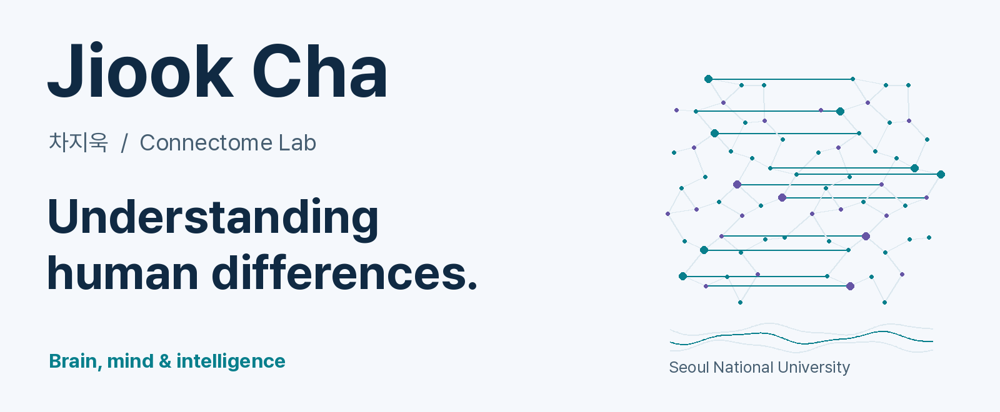
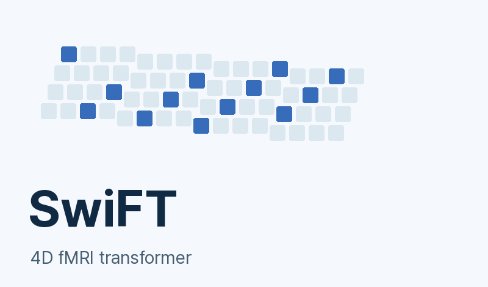
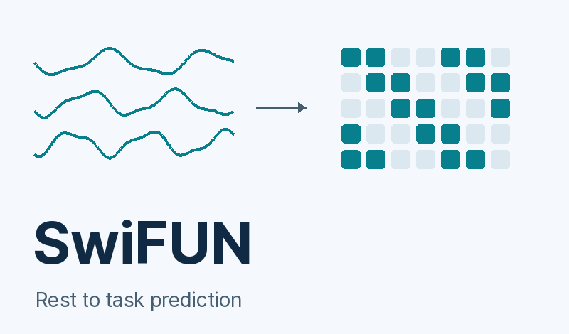
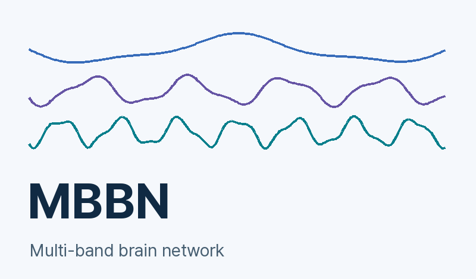
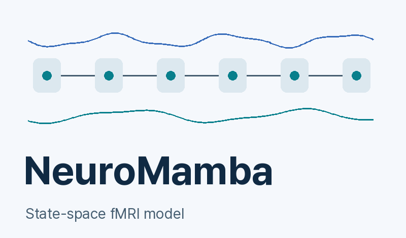

<a href="https://www.connectomelab.com"><picture><source media="(prefers-color-scheme: dark) and (max-width: 600px)" srcset="assets/hero-dark-mobile.png"><source media="(max-width: 600px)" srcset="assets/hero-light-mobile.png"><source media="(prefers-color-scheme: dark)" srcset="assets/hero-dark.png"></picture></a>

[Lab website](https://www.connectomelab.com) · [Publications](https://scholar.google.com/citations?user=fHSAoOoAAAAJ) · [Research code](https://github.com/Transconnectome) · [Email](mailto:connectome@snu.ac.kr)

**Jiook Cha · 차지욱** 
Associate Professor, Seoul National University · PI, Connectome Lab 
서울대학교 심리학과 · 협동과정 인공지능전공(IPAI) · 뇌인지과학과 부교수

Why do people think, feel and develop differently? We study connections
between genes, brains, behavior and environments, combining neuroscience
with AI models of brain activity.

**사람마다 생각하고 느끼며 자라나는 모습은 왜 다를까요?** 
유전·뇌·행동·환경의 연결에서 인간의 개인차를 연구합니다.
잘 예측하는 것과 왜 그런지 설명하는 것 사이의 거리를 좁히고자 합니다.

### Selected research code

<a href="https://github.com/Transconnectome/SwiFT"><picture><source media="(prefers-color-scheme: dark)" srcset="assets/card-swift-dark.png"></picture></a> <a href="https://github.com/Transconnectome/SwiFUN"><picture><source media="(prefers-color-scheme: dark)" srcset="assets/card-swifun-dark.png"></picture></a>

<a href="https://github.com/Transconnectome/MBBN"><picture><source media="(prefers-color-scheme: dark)" srcset="assets/card-mbbn-dark.png"></picture></a> <a href="https://github.com/Transconnectome/NeuroMamba"><picture><source media="(prefers-color-scheme: dark)" srcset="assets/card-neuromamba-dark.png"></picture></a>

- [**SwiFT**](https://github.com/Transconnectome/SwiFT) learns from the spatial and temporal structure of 4D fMRI.
- [**SwiFUN**](https://github.com/Transconnectome/SwiFUN) predicts task-related brain activity from resting-state dynamics.
- [**MBBN**](https://github.com/Transconnectome/MBBN) learns brain dynamics across frequency bands.
- [**NeuroMamba**](https://github.com/Transconnectome/NeuroMamba) explores state-space models for fMRI.

### Research across scales

Brain foundation models · Computational psychiatry & imaging genetics 
Affective neuroscience · Quantum machine learning for brain signals

<strong>연구 분야 자세히 보기 / Research in detail</strong>

사람마다 생각하고 느끼며 자라나는 모습은 왜 다를까요? 
**유전·뇌·행동·환경의 연결**에서 인간의 인지, 정서, 발달, 정신건강의 개인차를 연구합니다. 현상을 설명하는 이론 모델과 대규모 뇌·행동 데이터에서 예측 패턴을 학습하는 AI 모델을 함께 다루며, **잘 예측하는 것과 왜 그런지 설명하는 것 사이의 거리를 좁히는 연구**를 지향합니다.

### 1. 뇌 파운데이션 모델 (Neuro-X: Brain Foundation Models)
* **질문**: 뇌 데이터로 학습한 AI로 인간의 인지·정서·행동을 어떻게 이해하고 예측할까?
* **연구**: fMRI의 시공간·주파수 패턴(**SwiFT**, **SwiFUN**, **MBBN**, **NeuroMamba**)과 다양한 기록 환경의 EEG·두개내 뇌파(**DIVER**)를 학습하는 파운데이션 모델을 개발하고, 새로운 사람과 과제에서의 일반화 및 신경 표현을 분석합니다.

### 2. 계산정신의학 및 발달·유전 (Computational Psychiatry & Imaging Genetics)
* **질문**: 유전·뇌·행동·환경은 아동·청소년의 발달과 정신건강에서 어떻게 연결될까?
* **연구**: 대규모 발달 코호트에서 다유전자 점수(PGS), 다중 모달 뇌영상(MRI), 가족력, 인지·행동 및 사회환경 지표를 결합하여 우울·자살 위험 등 정신건강과 발달 궤적의 개인차를 다층적으로 규명합니다.

### 3. 정서 신경과학 (Affective Neuroscience)
* **질문**: 말로 다 담기 어려운 복합적인 정서와 기억 경험은 뇌 활동과 어떻게 연결될까?
* **연구**: 가상현실(VR), 경험 보고, 뇌파(EEG)를 결합해 경외(awe) 같은 양가적·복합적 정서와 개인적 기억 회상 과정의 역동을 측정하고, 정서 변화를 음악·영상 생성에 반영하는 방법을 탐구합니다.

### 4. 뇌신호·시계열 양자 머신러닝 (Quantum Machine Learning)
* **질문**: 양자 계산은 복잡한 뇌 시계열 신호를 표현하고 학습하는 데 어떤 가능성을 열까?
* **연구**: 양자 회로와 고전 신경망(양자 시계열 트랜스포머, **Q-DIVER**, 멀티칩 앙상블)을 결합해 뇌신호 학습의 파라미터 효율성, 하드웨어 확장 제약, 잡음 환경에서의 학습 안정성을 검증합니다.

### Explore & connect

[Connectome Lab](https://www.connectomelab.com) for research, people and news. 
[Google Scholar](https://scholar.google.com/citations?user=fHSAoOoAAAAJ) for publications. 
[Transconnectome](https://github.com/Transconnectome) · [NeuroX](https://github.com/neurox-org) for more code.

[connectome@snu.ac.kr](mailto:connectome@snu.ac.kr) · 서울대학교 16동 M512호
